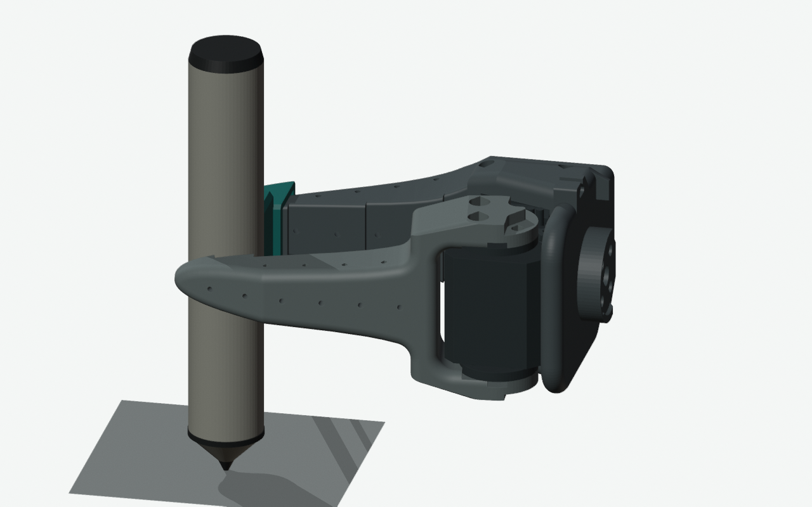
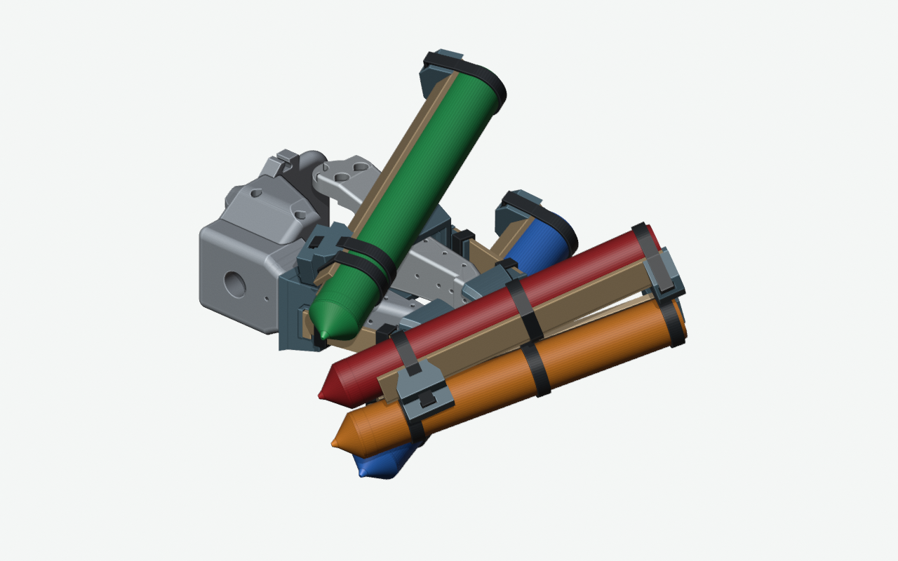
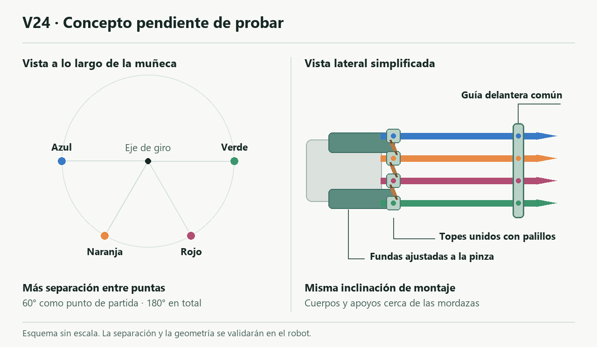

# Cabezal de cuatro colores para el SO-101

**Diseño mecánico y prototipado por [Ander Mont](https://github.com/andermont).**

Empecé con un rotulador en la pinza de un SO-101. La idea era llegar a cuatro colores y elegir cuál pinta con el giro de muñeca que ya trae el robot.

Para la demo conseguí que dos colores pintaran por separado con un montaje de cinta. La V23 fue la versión impresa que probé con cuatro. El montaje tenía demasiada holgura para la precisión que pedía el diseño.

## Un rotulador

Lo primero era agarrar un rotulador y probar a dibujar. Hice una guía de una pieza que va sobre el dedo fijo. La mordaza móvil aprieta el rotulador contra una cuna en V.

[Modelo Blender](modelos/SO101_Guia_Fija.blend) · [Archivo de impresión](modelos/SO101_Guia_Fija.3mf)

## Cuatro rotuladores con bridas

Pasé a dos pares de rotuladores. Los escaloné para hacer sitio a los cuerpos y usé dos bridas por rotulador. En este diseño, pasar por las cuatro posiciones requería **270° de giro**. En el brazo medimos **250° útiles**, de −80° a 170°. El diseño tenía que respetar ese recorrido.

[Modelo Blender](modelos/SO101_Cabezal_4_Colores.blend) · [Cuerpo STL](modelos/SO101_Cabezal_4_Colores.stl)

## Sujeción impresa con carraca

Quería poder cambiar un rotulador sin cortar una brida cada vez. Probé un cierre impreso con bisagra y carraca. El cierre me pareció demasiado endeble, y el rotulador necesitaba quedar firme tanto cerca de la punta como en el extremo trasero.

[V10 en Blender](modelos/SO101_V10.blend) · [Muestra de un cierre](modelos/Prueba_carraca_D19-1.3mf)

## De la V17 a la V18 · Más apoyo alrededor de la pinza

Pedí formas más simples y más apoyo alrededor de la pinza. También incliné los rotuladores de forma distinta para acercar sus cuerpos al brazo. Cuanto más cerca queda la masa de la pinza y de la muñeca, menos palanca hace. La V17 agrupaba las puntas en un arco con **21° entre colores**. En CAD, cada punta llegaba a la misma marca al girar la muñeca.

Al preparar la impresión de esta etapa, nos presupuestaron cerca de **12 horas**. La captura del laminador mostraba **11 h 28 min** con boquilla de **0,2 mm** y capas de **0,10 mm**. Buscaba acercarme a **3–4 horas**, así que empecé a sacar de la impresión todo lo que podía montar con materiales corrientes.

[V17 en Blender](modelos/SO101_V17.blend) · [Esquema de giro de la V17](imagenes/v17-seleccion-color.png) · [Placa de la V18](modelos/SO101_V18.3mf) · [Vista de la cama de la V18](imagenes/v18-placa-impresion.png)

## V23 · Listones y bridas

Dejé impresos el puente, las fundas, las cunas y los topes. El resto lo monté con listones y bridas de bazar. La placa quedó en diez piezas y la pieza más alta rondaba los **24 mm**.

En el montaje real tuve que rellenar las fundas porque se movían sobre las mordazas. Además, el puente, las fundas y los listones se condicionaban entre sí. Era difícil montar y ajustar una pieza sin tener que recolocar otra.

El CAD dejaba unos **4 mm** entre el papel y la punta vecina cuando un color estaba en posición. Entre la flexión, la holgura y cómo habían quedado montados los rotuladores, llegaron a marcar las cuatro puntas juntas. Solo conseguí aislar el azul y el verde, que quedaban en los extremos.

[V23 en Blender](modelos/SO101_V23_Plana.blend) · [Placa 3MF](modelos/SO101_V23_Impresion.3mf) · [Vista de la cama](imagenes/v23-placa-impresion.png) · [Manual de montaje](MANUAL.md)

## V24 · Qué cambiaría

- **Dar más giro entre colores.** Quiero ganar margen para que cada punta escriba sola. Las cuatro posiciones tienen que caber en el recorrido útil de la muñeca.
- **Montar los rotuladores con la misma inclinación.** Los pondría lo más cerca posible de las pinzas. Así es más fácil colocar las puntas y hacer una guía común.
- **Unir los apoyos delanteros.** Una guía rígida común cerca de las puntas mantendría fija su separación al escribir.
- **Unir los topes traseros con palillos.** Haría huecos orientados en las piezas que sujetan la parte trasera de los rotuladores. Cada palillo encajaría en la dirección que toca, fijando la posición relativa de los topes. Así se evita que cada rotulador pueda bascular por su cuenta.
- **Hacer que las fundas ajusten a las mordazas.** Tienen que cubrirlas y apoyar tanto por dentro como por fuera. Así el cabezal queda firme sin tener que rellenar los huecos.
- **Poder montar por etapas.** Primero fijaría la base con las fundas a las pinzas. Después añadiría la guía delantera, los apoyos traseros, los palillos y los rotuladores. Quiero poder revisar y ajustar cada paso con el anterior ya fijo.

La V24 está planteada. Quiero seguir usando materiales caseros donde tenga sentido e imprimir las piezas que fijan la geometría. La prueba será hacer varios cambios de color y dibujar un trazo con cada uno, con presión de escritura y los cuatro montados. Tiene que pintar solo el que toca, sin recolocar los rotuladores entre trazos.

[Secuencia de montaje propuesta para la V24](MANUAL.md#v24-secuencia-propuesta)

## Créditos

El cabezal se diseñó para el SO-101. Las mallas del robot incluidas como referencia en los modelos Blender proceden de [TheRobotStudio/SO-ARM100](https://github.com/TheRobotStudio/SO-ARM100) y conservan su [licencia Apache 2.0](licencias/Apache-2.0.txt). En las escenas se han colocado y orientado para enseñar el montaje.
