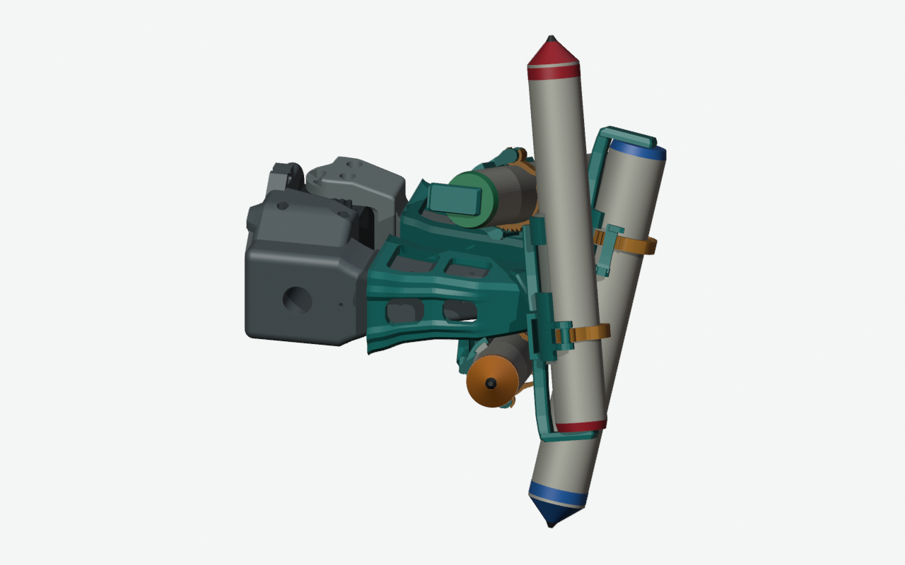
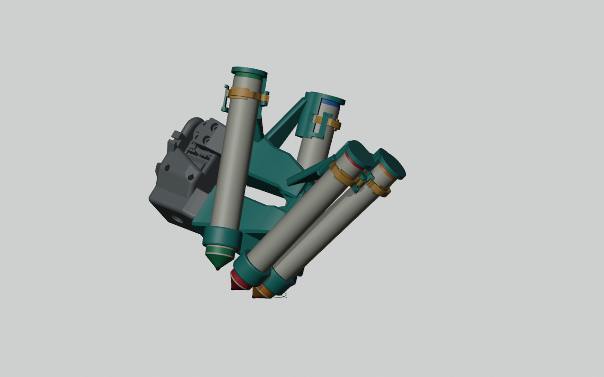
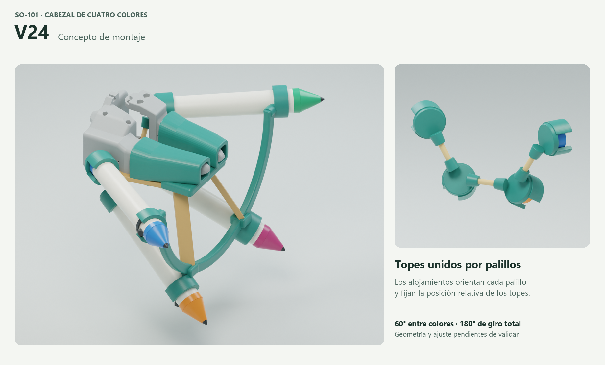
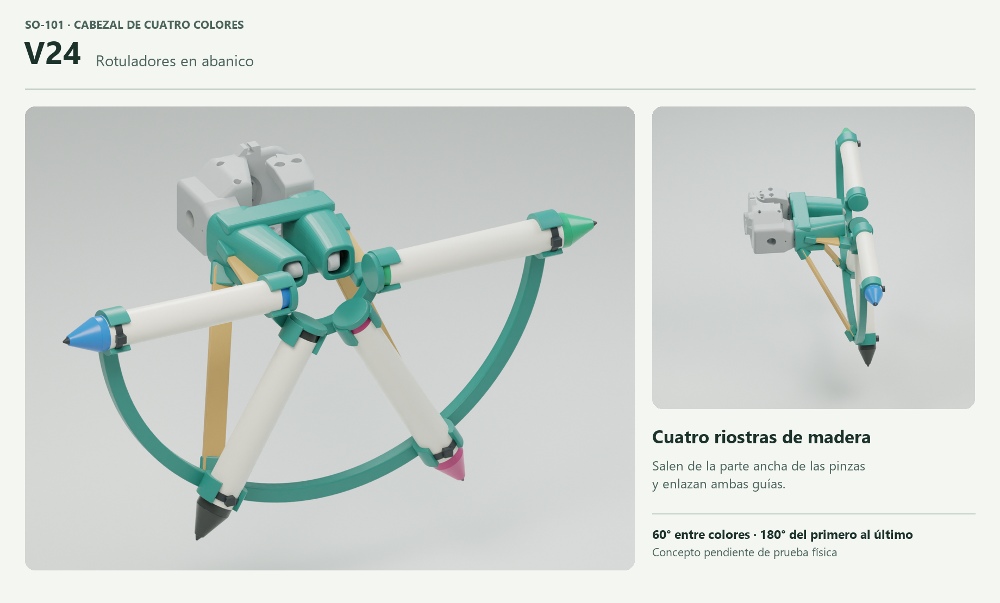
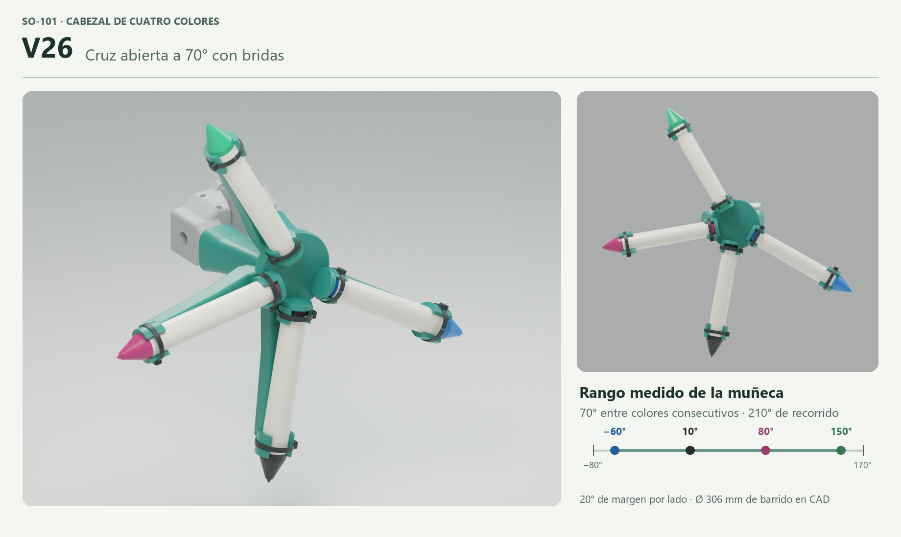
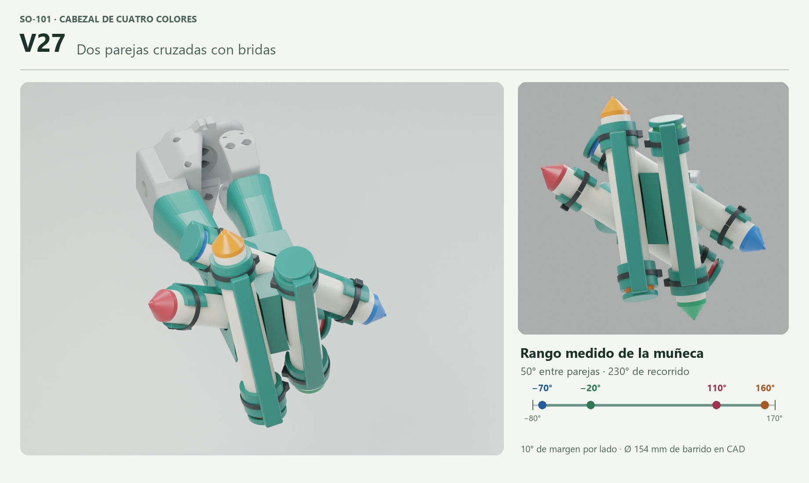
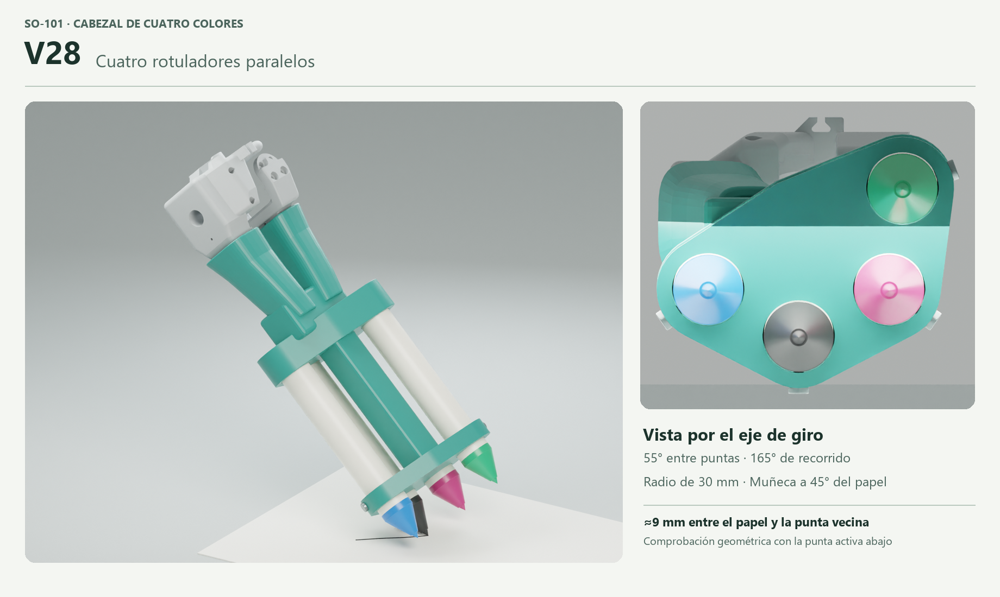

# Cabezal de cuatro colores para el SO-101

**Diseño mecánico y prototipado por [Ander Mont](https://github.com/andermont).**

Empecé con un rotulador en la pinza de un SO-101. La idea era llegar a cuatro colores y elegir cuál pinta con el giro de muñeca que ya trae el robot.

Para la demo conseguí que dos colores pintaran por separado con un montaje de cinta. La V23 fue la versión impresa que probé con cuatro. El montaje tenía demasiada holgura para la precisión que pedía el diseño.

## Un rotulador

Lo primero era agarrar un rotulador y probar a dibujar. Hice una guía de una pieza que va sobre el dedo fijo. La mordaza móvil aprieta el rotulador contra una cuna en V.

[Modelo Blender](modelos/SO101_Guia_Fija.blend) · [Archivo de impresión](modelos/SO101_Guia_Fija.3mf)

## Cuatro rotuladores con bridas

Pasé a dos pares de rotuladores. Los escaloné para hacer sitio a los cuerpos y usé dos bridas por rotulador. En este diseño, pasar por las cuatro posiciones requería **270° de giro**. En el brazo medimos **250° útiles**, de −80° a 170°. El diseño tenía que respetar ese recorrido.

[Modelo Blender](modelos/SO101_Cabezal_4_Colores.blend) · [Cuerpo STL](modelos/SO101_Cabezal_4_Colores.stl)

## Sujeción impresa con carraca

Quería poder cambiar un rotulador sin cortar una brida cada vez. Probé un cierre impreso con bisagra y carraca. El cierre me pareció demasiado endeble, y el rotulador necesitaba quedar firme tanto cerca de la punta como en el extremo trasero.

[V10 en Blender](modelos/SO101_V10.blend) · [Muestra de un cierre](modelos/Prueba_carraca_D19-1.3mf)

## De la V17 a la V18 · Más apoyo alrededor de la pinza

Pedí formas más simples y más apoyo alrededor de la pinza. También incliné los rotuladores de forma distinta para acercar sus cuerpos al brazo. Cuanto más cerca queda la masa de la pinza y de la muñeca, menos palanca hace. La V17 agrupaba las puntas en un arco con **21° entre colores**. En CAD, cada punta llegaba a la misma marca al girar la muñeca.

Al preparar la impresión de esta etapa, nos presupuestaron cerca de **12 horas**. La captura del laminador mostraba **11 h 28 min** con boquilla de **0,2 mm** y capas de **0,10 mm**. Buscaba acercarme a **3–4 horas**, así que empecé a sacar de la impresión todo lo que podía montar con materiales corrientes.

[V17 en Blender](modelos/SO101_V17.blend) · [Esquema de giro de la V17](imagenes/v17-seleccion-color.png) · [Placa de la V18](modelos/SO101_V18.3mf) · [Vista de la cama de la V18](imagenes/v18-placa-impresion.png)

## V23 · Listones y bridas

Dejé impresos el puente, las fundas, las cunas y los topes. El resto lo monté con listones y bridas de bazar. La placa quedó en diez piezas y la pieza más alta rondaba los **24 mm**.

En el montaje real tuve que rellenar las fundas porque se movían sobre las mordazas. Además, el puente, las fundas y los listones se condicionaban entre sí. Era difícil montar y ajustar una pieza sin tener que recolocar otra.

El CAD dejaba unos **4 mm** entre el papel y la punta vecina cuando un color estaba en posición. Entre la flexión, la holgura y cómo habían quedado montados los rotuladores, llegaron a marcar las cuatro puntas juntas. Solo conseguí aislar el azul y el verde, que quedaban en los extremos.

[V23 en Blender](modelos/SO101_V23_Plana.blend) · [Placa 3MF](modelos/SO101_V23_Impresion.3mf) · [Vista de la cama](imagenes/v23-placa-impresion.png) · [Manual de montaje](MANUAL.md)

## V24 · Qué cambiaría

En el render he usado 60° entre colores como punto de partida. Los cuatro rotuladores van con la misma inclinación. Queda por probar el ajuste en las mordazas y cuánto cede el conjunto al escribir. [Ver el esquema de montaje](imagenes/06-v24-concepto.png).

- **Dar más giro entre colores.** Quiero ganar margen para que cada punta escriba sola. Las cuatro posiciones tienen que caber en el recorrido útil de la muñeca.
- **Montar los rotuladores con la misma inclinación.** Los pondría lo más cerca posible de las pinzas. Así es más fácil colocar las puntas y hacer una guía común.
- **Unir los apoyos delanteros.** Una guía rígida común cerca de las puntas mantendría fija su separación al escribir.
- **Unir los topes traseros con palillos.** Haría huecos orientados en las piezas que sujetan la parte trasera de los rotuladores. Cada palillo encajaría en la dirección que toca, fijando la posición relativa de los topes. Así se evita que cada rotulador pueda bascular por su cuenta.
- **Usar los palos de helado tal cual.** En la V23 fue muy tedioso hacer las muescas a mano. En la V24 quitaría ese paso y dejaría el encaje resuelto en las piezas impresas.
- **Hacer que las fundas ajusten a las mordazas.** Tienen que cubrirlas y apoyar tanto por dentro como por fuera. Así el cabezal queda firme sin tener que rellenar los huecos.
- **Poder montar por etapas.** Primero fijaría la base con las fundas a las pinzas. Después añadiría la guía delantera, los apoyos traseros, los palillos y los rotuladores. Quiero poder revisar y ajustar cada paso con el anterior ya fijo.

La V24 está planteada. Quiero seguir usando materiales caseros donde tenga sentido e imprimir las piezas que fijan la geometría. La prueba será hacer varios cambios de color y dibujar un trazo con cada uno, con presión de escritura y los cuatro montados. Tiene que pintar solo el que toca, sin recolocar los rotuladores entre trazos.

[Secuencia de montaje propuesta para la V24](MANUAL.md#v24-secuencia-propuesta)

### Variante en abanico

En esta variante puse los cuatro rotuladores en un plano perpendicular a la pinza, con los culos juntos y 60° entre cada par de vecinos. Una pieza común agrupa los topes traseros y una guía une los apoyos cerca de las puntas. Desde la parte ancha de las pinzas salen dos palos de helado hacia cada guía. Esta disposición ocupa más espacio alrededor del eje de giro. Queda por probar la rigidez del montaje y que solo pinte una punta cada vez.

## V25 — Cruz con bridas

Volvería a la forma del [primer cabezal de cuatro colores](#cuatro-rotuladores-con-bridas). Haría dos fundas que abracen las mordazas por dentro y por fuera, un bloque central con cuatro alojamientos que hagan tope en los culos y una cuna rígida cerca de cada punta. Las bridas aprietan los rotuladores contra las cunas. El tope trasero fija cuánto sobresale cada rotulador y los dos apoyos mantienen su ángulo. Para que los cuatro lleguen a la misma marca al girar, las puntas tienen que quedar al mismo radio y en la misma posición a lo largo del eje.

Una cruz exacta de 90° necesita 270° para seleccionar los cuatro colores solo con el giro de muñeca. El recorrido medido es de 250°, entre −80° y 170°.

- **Mantener los 90°.** Unir la base de las fundas al portador mediante un acople centrado en el eje de la muñeca, con dos posiciones separadas 90°. Lo giraría a mano con el cabezal levantado y lo bloquearía con un pasador. La muñeca tendría tres colores accesibles en cada posición del acople. La segunda posición daría acceso al cuarto color.
- **Cambiar los cuatro colores solo con la muñeca.** Mantener las fundas, las bridas y los dos apoyos por rotulador, con 70° entre colores consecutivos dentro del arco de trabajo. Los objetivos −60°, 10°, 80° y 150° ocupan 210° y dejan 20° de margen por lado. La separación entre el último y el primero por el otro lado sería de 150°.

La V25 queda como concepto. La prueba de montaje es dibujar con presión real, cambiar de color varias veces y comprobar que solo marque la punta activa y que vuelva a la misma marca.

## V26 — Cruz abierta a 70° con bridas

En esta versión llevo al CAD la opción de la V25 que permite cambiar los cuatro colores con la muñeca. Las fundas rodean las dos mordazas. Un bloque central hace tope en los culos y cada rotulador tiene otra cuna cerca de la punta. Dos bridas por rotulador lo mantienen asentado. Los nervios impresos unen las cunas al bloque central.

Probé las cuatro posiciones en el modelo. Las puntas llegan a la misma marca y el rotulador vecino más bajo queda a unos 95 mm del plano del papel. Con rotuladores de 130 mm, la punta queda a 153 mm del eje y el cabezal barre unos 306 mm de diámetro. A esa distancia, 1° de holgura desplaza la punta unos 2,7 mm. Para probarlo en el robot queda comprobar el espacio de giro, el ajuste de las fundas y cuánto flexa al escribir.

## V27 — Dos parejas cruzadas con bridas

Recuperé la disposición del [primer cabezal de cuatro colores](#cuatro-rotuladores-con-bridas). Hay dos parejas superpuestas y los rotuladores de cada pareja apuntan en sentidos opuestos. Cerré el cruce de 90° a 50°. Los cuatro colores se seleccionan en −70°, −20°, 110° y 160°, con 10° de margen en cada extremo del recorrido medido.

Incliné los rotuladores unos 11° en sentido axial para que las puntas de las dos parejas lleguen a la misma marca sin que los cuerpos se crucen físicamente. Cada rotulador tiene dos cunas con bridas y un tope para el culo conectado al bloque central. En CAD, con rotuladores de 130 mm, el diámetro de giro queda en unos 154 mm y el rotulador inactivo más bajo queda a unos 19,5 mm del papel. Queda por comprobar el ajuste de las fundas y la rigidez al escribir.

## V28 - Rotuladores paralelos al eje de giro

Con 200° de recorrido de muñeca, separé las puntas 55° entre colores. Los cuatro ocupan 165°, con 17,5° de margen por lado si centro el cabezal en el recorrido. Una placa trasera hace de tope y la delantera guía y aprieta cada rotulador cerca de la punta. Un travesaño une las dos placas.

En CAD, con el eje de muñeca a 45° respecto al papel y las puntas a 30 mm del eje, los cuatro colores llegan a la misma marca. La punta vecina queda unos 9 mm por encima del papel. El cono del rotulador activo pasa a 0,7 mm del papel en el modelo. Queda por probar ese margen con los rotuladores reales y si el robot puede mantener la inclinación en toda la zona de dibujo.

**Cómo cambié la forma de iterar.** Pasar por renders antes de preparar los modelos para imprimir me permite probar ideas mucho más rápido. Antes me ponía directamente con el modelo porque pensaba que estaba más cerca de tener una versión imprimible de lo que realmente estaba.

## Créditos

El cabezal se diseñó para el SO-101. Las mallas del robot incluidas como referencia en los modelos Blender proceden de [TheRobotStudio/SO-ARM100](https://github.com/TheRobotStudio/SO-ARM100) y conservan su [licencia Apache 2.0](licencias/Apache-2.0.txt). En las escenas se han colocado y orientado para enseñar el montaje.
