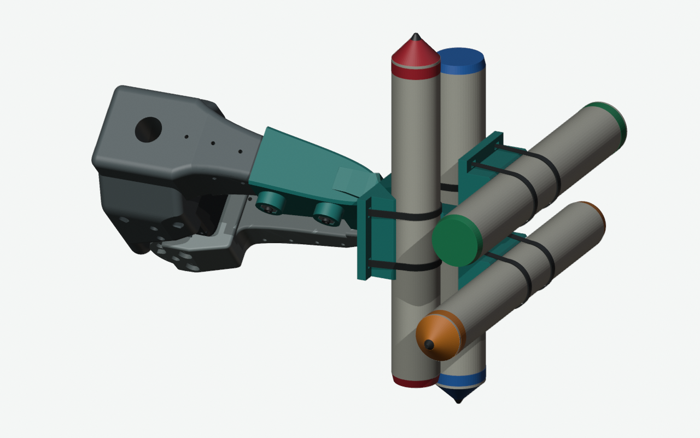
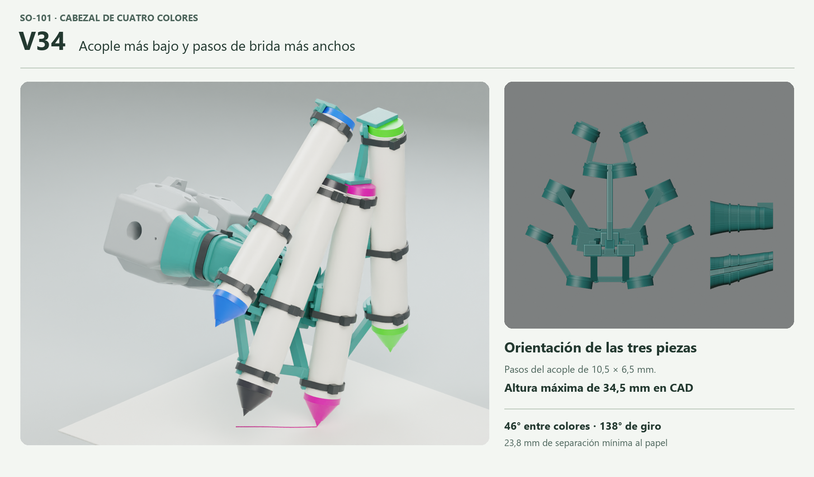

# Cabezal de cuatro colores para el SO-101

**Diseño mecánico y prototipado por [Ander Mont](https://github.com/andermont).**

Empezamos con un rotulador en la pinza de un SO-101. La idea era llegar a cuatro colores y elegir cuál pinta con el giro de muñeca que ya trae el robot.

Para la demo conseguimos que dos colores pintaran por separado con un montaje de cinta. La V23 fue la versión impresa que probamos con cuatro. El montaje tenía demasiada holgura para la precisión que pedía el diseño.

## Un rotulador

Lo primero era agarrar un rotulador y probar a dibujar. Hicimos una guía de una pieza que va sobre el dedo fijo. La mordaza móvil aprieta el rotulador contra una cuna en V.

[Modelo Blender](modelos/SO101_Guia_Fija.blend) · [Archivo de impresión](modelos/SO101_Guia_Fija.3mf)

## Cuatro rotuladores con bridas

Pasamos a dos pares de rotuladores. Los escalonamos para hacer sitio a los cuerpos y usamos dos bridas por rotulador. En este diseño, pasar por las cuatro posiciones requería **270° de giro**. En el brazo medimos **250° útiles**, de −80° a 170°. El diseño tenía que respetar ese recorrido.

[Modelo Blender](modelos/SO101_Cabezal_4_Colores.blend) · [Cuerpo STL](modelos/SO101_Cabezal_4_Colores.stl)

## Sujeción impresa con carraca

Queríamos poder cambiar un rotulador sin cortar una brida cada vez. Probamos un cierre impreso con bisagra y carraca. El cierre nos pareció demasiado endeble, y el rotulador necesitaba quedar firme tanto cerca de la punta como en el extremo trasero.

[V10 en Blender](modelos/SO101_V10.blend) · [Muestra de un cierre](modelos/Prueba_carraca_D19-1.3mf)

## De la V17 a la V18 · Más apoyo alrededor de la pinza

Buscamos formas más simples y más apoyo alrededor de la pinza. También inclinamos los rotuladores de forma distinta para acercar sus cuerpos al brazo. Cuanto más cerca queda la masa de la pinza y de la muñeca, menos palanca hace. La V17 agrupaba las puntas en un arco con **21° entre colores**. En CAD, cada punta llegaba a la misma marca al girar la muñeca.

Al preparar la impresión de esta etapa, nos presupuestaron cerca de **12 horas**. La captura del laminador mostraba **11 h 28 min** con boquilla de **0,2 mm** y capas de **0,10 mm**. Buscábamos acercarnos a **3–4 horas**, así que empezamos a sacar de la impresión todo lo que podíamos montar con materiales corrientes.

[V17 en Blender](modelos/SO101_V17.blend) · [Esquema de giro de la V17](imagenes/v17-seleccion-color.png) · [Placa de la V18](modelos/SO101_V18.3mf) · [Vista de la cama de la V18](imagenes/v18-placa-impresion.png)

## V23 · Listones y bridas

Dejamos impresos el puente, las fundas, las cunas y los topes. El resto lo montamos con listones y bridas de bazar. La placa quedó en diez piezas y la pieza más alta rondaba los **24 mm**.

Al sacar las piezas de la impresora nos costó quitar el material de soporte de los huecos pequeños. Para la siguiente versión buscamos reducir los huecos cerrados y dejar pasos de brida cortos y holgados donde hacían falta. Si la brida puede ir por fuera, un labio basta para que se quede en su sitio.

En el montaje real tuvimos que rellenar las fundas porque se movían sobre las mordazas. Echamos en falta una estructura que pudiéramos fijar primero a las pinzas y usar como base para acoplar el resto. El puente, las fundas y los listones se condicionaban entre sí. Era difícil montar y ajustar una pieza sin tener que recolocar otra.

El CAD dejaba unos **4 mm** entre el papel y la punta vecina cuando un color estaba en posición. Entre la flexión, la holgura y cómo habían quedado montados los rotuladores, llegaron a marcar las cuatro puntas juntas. Solo conseguimos aislar el azul y el verde, que quedaban en los extremos.

[V23 en Blender](modelos/SO101_V23_Plana.blend) · [Placa 3MF](modelos/SO101_V23_Impresion.3mf) · [Vista de la cama](imagenes/v23-placa-impresion.png) · [Manual de montaje](MANUAL.md)

## De la V24 a la V34 · Cómo llegamos al diseño actual

Tuvimos que hacer varias iteraciones hasta dar con un diseño coherente. La prueba de la V23 nos dejó tres problemas que había que resolver a la vez. Cada punta tenía que pintar sola y llegar a la misma marca, el conjunto tenía que quedar firme en la pinza y el montaje tenía que poder hacerse por etapas.

| Versiones | Qué probamos y qué nos llevamos |
| --- | --- |
| **V24** | Exploramos un montaje con más separación angular y apoyos unidos por delante y por detrás. También planteamos fijar las fundas primero para poder añadir y ajustar el resto después. [Concepto](imagenes/07-v24-render.png) · [Variante en abanico](imagenes/08-v24-abanico.png) · [Secuencia de montaje](MANUAL.md#v24-secuencia-propuesta) |
| **V25 a V28** | Probamos cruces abiertos, parejas cruzadas y rotuladores paralelos al eje de giro. Estas variantes nos sirvieron para comparar cuánto giro necesitábamos, cuánto espacio barría el cabezal y cuánta holgura quedaba entre las puntas inactivas y el papel. [V26](imagenes/09-v26-cruz-70.png) · [V27](imagenes/10-v27-dos-parejas.png) · [V28](imagenes/11-v28-rotuladores-paralelos.png) |
| **V29 a V32** | Volvimos a montar los rotuladores casi perpendiculares a la pinza. Unimos las guías delanteras y los topes traseros, abrimos las cunas para facilitar el paso de las bridas y acortamos las uniones para reducir material. Ajustamos las cuatro puntas a un radio común de 78 mm. [V29](imagenes/12-v29-guia-comun.png) · [Despiece V30](imagenes/14-v30-despiece.png) · [V31 en Blender](modelos/SO101_V31.blend) · [V32 en Blender](modelos/SO101_V32.blend) |
| **V33 y V34** | Separamos el portarrotuladores de las dos fundas. Los tetones lo posicionan y las bridas fijan el acople después de montar las fundas. En la V34 bajamos la altura máxima en cama de 42 a 34,5 mm y ensanchamos los pasos de brida hasta 10,5 × 6,5 mm en el acople y 10 × 6 mm en el centro. [V33 en Blender](modelos/SO101_V33.blend) · [V34 en Blender](modelos/SO101_V34.blend) |

Empezamos a comparar las ideas con renders antes de preparar cada modelo para impresión. Eso nos permitió iterar más rápido sobre la separación de las puntas, los apoyos y el orden de montaje.

### V34 frente a la V23

En la prueba de la V23 solo conseguimos aislar el azul y el verde. En el CAD de la V34 dejamos **46° entre colores consecutivos**. Los cuatro rotuladores llegan a la misma marca con **138° de giro total**. Queda por preparar las mallas para laminar y comprobar el ajuste y el contacto con el papel en el robot.

| | V23 | V34 |
| --- | --- | --- |
| Distancia del papel a la punta inactiva más baja, en CAD | Unos 4 mm | 23,8 mm |
| Piezas y montaje | 10 piezas impresas, listones con muescas y bridas | 3 piezas previstas para imprimir. Primero ajustamos las dos fundas con sus bridas. Después encajamos el portarrotuladores con dos tetones y lo aseguramos con otras dos bridas. |
| Volumen de geometría impresa | 31,7 cm³ | 50,2 cm³, unos 18,5 cm³ más (+58 %) |
| Peso de las piezas impresas | 30 g de referencia | Unos 47–48 g si se mantiene la proporción de masa a volumen de la V23 |
| Altura máxima en la orientación de cama | Unos 24 mm | 34,5 mm |
| Tiempo de impresión | Aproximadamente 1 h 30 min en la prueba | Pendiente de laminar con el perfil de la V23 |

La V34 lleva más plástico porque el portarrotuladores incorpora los tirantes que en la V23 eran de madera. Si el tiempo escalara solo con el volumen de las piezas, los 90 minutos de la V23 equivaldrían a unas **2 h 20 min** para la V34. Es una referencia orientativa. La altura, los soportes y el recorrido de la boquilla pueden cambiar el resultado. Los **11 h 28 min** de la V18 corresponden a otra geometría y otro perfil.

## Créditos

El cabezal se diseñó para el SO-101. Las mallas del robot incluidas como referencia en los modelos Blender proceden de [TheRobotStudio/SO-ARM100](https://github.com/TheRobotStudio/SO-ARM100) y conservan su [licencia Apache 2.0](licencias/Apache-2.0.txt). En las escenas se han colocado y orientado para enseñar el montaje.
